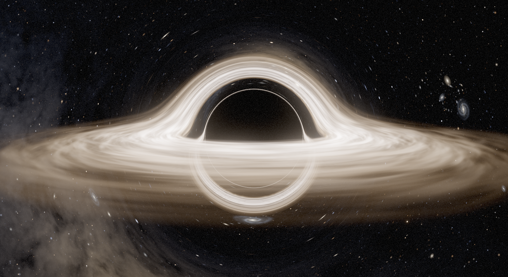

# Black Hole Simulation

A real-time, physically based renderer of a Schwarzschild black hole in the style of
*Interstellar*'s Gargantua, written in C++20 and OpenGL 4.6. Every pixel traces a light
ray backwards through curved spacetime, so the shadow, the photon ring, the disk wrapping
over and under the hole, and the Einstein-ring stretching of background stars all come
out of the physics rather than from tricks. You can fly around freely.



## Start it

```bash
cd /mnt/storage/BlackholeSimulation
./run.sh                # builds what changed, then opens the window on the RTX 3060
./run.sh --fullscreen   # same, fullscreen
```

`run.sh` always runs an incremental build first (it prints `ninja: no work to do.` when
nothing changed), so edits and updates are picked up automatically. The very first build
downloads GLFW 3.4, GLM, Dear ImGui, glad2 and stb. The mouse is captured for flying as soon
as the window opens: press **Tab** (or Esc) to get the cursor back for the settings panel,
and **Esc** again to quit. Run the physics checks with `ctest --test-dir build`.

Manual build, if you prefer:

```bash
cmake -S . -B build -G Ninja -DCMAKE_BUILD_TYPE=Release
cmake --build build
./build/blackhole
```

System requirements: a C++20 compiler, CMake 3.24+, Ninja (`ninja-build`, optional but faster),
Python 3 with `jinja2` (for the OpenGL loader generator), the X11/Wayland development headers and libEGL.

### Which GPU renders, and how the picture reaches the screen

The laptop's panel is wired to the Radeon iGPU, so frames rendered on the RTX 3060 have to be
handed over to it. The app picks the route by itself:

* **Wayland session with the NVIDIA driver loaded (the normal case here):** the window is a
  native Wayland window on the iGPU, all rendering happens on the RTX 3060 in a headless EGL
  context, and each finished frame is copied across with an asynchronous readback
  (about 1.7 ms per 1080p frame). See `src/GpuBridge.cpp`.
* **`--x11`, or an X11 session:** classic PRIME render offload through GLX. On this machine
  XWayland's GPU acceleration fails to start (`Failed to initialize glamor, falling back to
  sw` in the session log), so under Wayland this route is stuck at about 17 fps at 1080p.
* **`--igpu`, or no NVIDIA driver:** everything on the Radeon.

The log line `OpenGL 4.6.0 NVIDIA ... | NVIDIA GeForce RTX 3060 Laptop GPU` and the top of the
settings panel show which GPU is rendering.

## Enabling the RTX 3060 (one-time)

On this laptop the NVIDIA driver is installed but its kernel module is rejected by Secure
Boot because the signing key was never enrolled (`modprobe: could not insert 'nvidia':
Key was rejected by service`). Enroll it once:

```bash
sudo mokutil --import /var/lib/shim-signed/mok/MOK.der   # choose a one-time password
sudo mokutil --timeout -1                                # wait at the blue screen instead of a 10 s countdown
sudo reboot
# Blue "MOK management" screen: Enroll MOK -> Continue -> Yes -> password -> Reboot
nvidia-smi                                               # must now list the RTX 3060
```

Alternatively disable Secure Boot in the BIOS. Without this the app still runs on the
Radeon iGPU (the first run then starts on the Medium preset; the choice is saved in
`settings.ini` next to this README). The app detects the driver automatically.

Optional desktop launcher (shows up in the app grid as *Black Hole Simulation*, starts fullscreen):

```bash
install -Dm644 blackhole.desktop ~/.local/share/applications/blackhole.desktop
```

## Performance

Measured with `--benchmark`. RTX 3060 Laptop at 1920x1080 fullscreen (through the Wayland
bridge, sustained clocks); Radeon iGPU in a 1854x1011 window:

| Preset | Internal res | Steps | Disk | RTX 3060 fps | iGPU fps |
|---|---|---|---|---|---|
| Low | 50 % | 200 | thin | 322 | 162 |
| Medium | 75 % | 300 | volumetric | 159 | 44 |
| High (default) | 100 % | 450 | volumetric | 74 | 21 |
| Ultra | 100 % | 700 | volumetric, fine | 49 | 14 |

With VSync on (the default) the frame rate is capped by the 144 Hz panel.

The renderer also supersamples progressively whenever the camera is still, so a paused view
keeps sharpening for a few seconds on any preset. *Dynamic resolution* in the Quality panel
holds a target frame time by scaling the internal resolution.

## Mass, time and planets

* **Black hole mass:** the *Black hole & time* panel has a mass slider from a few suns to ten
  billion, with presets for a stellar-mass hole, Sagittarius A*, Gargantua (the default, 100 million
  suns) and M87*. The hole looks the same at every mass (everything near it is measured in units of
  its mass); what changes is how big physical things such as planets and stars are next to it, and
  how strong its tides are.
* **Time warp:** from slow motion to a thousand years per second, with presets. Orbits, and later
  the star disruption, follow the simulated clock; the disk's swirl keeps its own pace so it stays
  readable. P pauses everything.
* **Planets:** three Interstellar-inspired worlds on exact circular Schwarzschild orbits: Miller
  (an ocean world just outside the innermost stable orbit), Mann (ice) and Edmunds (desert). Each
  shows its orbital period, speed and how much slower time runs there, and warns when an orbit is
  unstable or when the hole's tides would tear the planet apart at the current mass. Planets are
  lensed like everything else, lit by the accretion disk, and drawn at their real size, so from the
  default view they are smaller than a pixel: use *Travel*.
* **Travel:** the *Travel* panel flies you to the black hole or any planet. Near a planet the camera
  rides along with it (Miller moves at almost half the speed of light). Flight speed follows the
  distance to the nearest surface, so you can creep along a planet's horizon or cross the system in
  seconds; scroll to scale it, Shift for 5x.

## The 3D universe

The *Universe* panel switches between three skies:

* **Painted backdrop:** the original look. Galaxies, nebulae and the Milky Way are painted onto a
  sky infinitely far away; it is lensed correctly but nothing in it has a position.
* **Invented 3D universe:** a generated universe (change the seed for another one). The black hole
  sits on a spiral arm of a Milky-Way-sized galaxy (often barred), with its spin tilted so the
  galaxy's band and glowing bulge cross behind it, lensed into an Einstein ring around the shadow.
  Every star has a real position: about 200,000 are generated around you from the galaxy's
  structure (blue giants crowd the arms, orange giants the old disk), and the ones you fly close to
  have planets. A few notable stars nearby have names (a blue and a red supergiant, a Sun-like
  star, a white dwarf, a binary...). Satellite galaxies, a big neighbour spiral and ~29,000
  galaxies in clusters, groups and filaments fill the universe. You can fly into any of them, or
  look at your own galaxy from outside.
* **Real 3D universe:** 119,613 real stars from the HYG catalogue, a model of the Milky Way and the
  solar system's planets at today's positions. The black hole is Sagittarius A* at the centre of the
  Milky Way (with its real mass, 4.3 million suns), or a fictional Gargantua placed near the Sun so
  the real constellations surround it. About 45,000 real galaxies (the Local Group, the Updated
  Nearby Galaxy Catalog and the 2MASS Redshift Survey, with Andromeda, M81, M51...) come from
  tables that may not be redistributed, so they are downloaded once on your machine: press
  *Download the real galaxies* in the Universe panel, or run `python3 tools/fetch_real_catalogs.py`
  (a few minutes; see `assets/real/README.md`).

How it is drawn: the stars are projected from the camera every frame on the GPU and looked up by
the ray tracer through the same lensing-aware math as before, so real stars stretch into arcs
around the black hole. Galaxies are 3D models (bulge, bar, a disk of old stars, spiral arms of
young blue stars with pink star-forming nebulae, and dust that reddens what lies behind it); their
light is ray-marched into a sky texture rebuilt from wherever you are, a strip at a time while you
travel. Distant galaxies are drawn as images oriented as they are in space. Stars close to the
camera become glowing, boiling discs with spots, and planets become lensed spheres.

**Travelling:** the *Travel* panel lists every named star, galaxy and place, with a search box and a
*Surprise me* button; flights cross any distance in a few seconds. In free flight the speed
follows the distance to the nearest surface (horizon, planet or star); **T** toggles a 1000x turbo
for crossing interstellar space by hand.

## Star disruption

The *Star disruption* panel spawns a star on a plunging orbit and simulates the black hole tearing
it apart on the GPU: the star stretches into a long stream, half of the gas escapes, the bound half
falls back, crashes into itself and forms a hot disk, and whatever crosses the horizon is eaten.
The gas is rendered with the same lensing as everything else.

* **Spawn star plays the selected scenario exactly**, including its black hole mass (your own comes
  back when the event is over); changing the star, the orbit or the mass by hand turns it into
  *Custom*, which keeps the current black hole.
* **Scenarios** pick a black hole mass, a star and an orbit, e.g. a Sun-like star around
  Sagittarius A* (torn apart close to the hole and strongly lensed) or a red supergiant around
  Gargantua. Whether a star is torn apart depends on its size and the hole's mass: Gargantua
  swallows Sun-like stars whole.
* **Penetration (beta)** sets how deep the orbit dives (pericentre = tidal radius / beta).
* **Auto time warp** keeps the event watchable: the fall-in takes days to centuries of simulated
  time depending on the scenario, and the debris keeps returning for much longer. The event runs on
  its own clock (shown in the panel); the planets and the rest of the world keep your time warp.
* **What it is doing** is captioned at the bottom of the screen (and in the panel), in five stages:
  falling in; torn apart (slow motion through the closest approach); the stream flies out (a
  time-lapse, weeks in seconds, that brakes just before the gas comes back, predicted from the
  debris' orbits); falling back (the returning gas crashes into the stream still falling in and
  heats up); feeding the black hole (the gas settles into a disk and spirals in). The whole event
  takes about a minute and a half.
* **The camera** films the event in three shots joined by cuts through black, so each change of
  view is deliberate: riding with the star, a fixed distance from it, as it falls in (the black hole
  looming behind it), is squeezed and stretched at the closest approach, and lengthens into a stream
  flowing past the camera (a Sun-like star is a twentieth of the shadow's size, so the tearing is a
  close-up); riding behind the departing stream with the hole shrinking in the distance; and a slow
  push-in over the hole as the gas comes back, circles it in a ring and spreads into the disk. Fly
  or look around at any time to take over; *Watch* hands the camera back.
* **The steady accretion disk fades out** during an event (a real disruption happens around a quiet
  black hole and builds its own disk from the debris): the returning gas circularises in a ring at
  about twice the pericentre distance, which spreads inward and brightens into the disk again while
  the hot cloud around the hole condenses into it, spiralling inwards. *Clear* ends the event (the
  disk also returns by itself after a star is swallowed whole), and *Keep the steady disk* keeps it
  throughout. The disk's on/off switch and rotation speed are in the *Black hole & time* section.
* **Gas brightness and opacity** (Star disruption panel) scale the debris' glow and absorption.

How it is simulated: until it reaches about twice the tidal radius the star moves rigidly on an
exact Schwarzschild orbit; then it becomes 262,144 particles (a polytrope in hydrostatic balance)
whose pressure, shock heating, cooling and self-gravity are computed on nested 64^3 grids around
the star and the hole, with general-relativistic orbits for every particle and accretion at the
horizon. The gas is drawn from the particles themselves: each becomes a small, soft splat at the
places the black hole's lensing shows it (its direct image and the one round the far side of the
hole), so the torn star stays sharp however near or far the camera is, and a stream thinner than a
pixel is drawn as a pixel-wide line, as an optically thick stream would look.

## Neutron-star merger (gamma-ray burst)

The *Neutron star merger* panel puts a pair of neutron stars in orbit around the black hole and plays
their collision: a short gamma-ray burst with its kilonova, directed in five stages like the star
disruption, about two minutes long.

* **Inspiral** (slow motion): two 1.4-solar-mass stars, 24 km across, start 120 km apart. Gravitational
  waves drain the orbit (Peters' quadrupole formula), so the whirl tightens and quickens, the chirp,
  until the stars touch about a second later after some sixty orbits. The camera rides with them, the
  black hole looming behind.
* **Merger**: they merge in a millisecond; a fiftieth of a solar mass of neutron-rich matter is flung
  out at a fifth of the speed of light (slower and redder towards the orbital plane) and, a moment
  later, twin jets a few degrees wide punch out along the spin axis inside a slower, wider cocoon.
  The flash engulfs the close camera, which cuts to one outside the fireball; that camera then pulls
  back steadily, keeping the swelling ball the same size while the black hole behind it shrinks (the
  ejecta grow a hundred-thousand-fold in a minute), until it reaches the wide view.
* **The burst** (time-lapse to about half an hour): the jets coast at almost the speed of light; their
  spines follow light-like paths in the hole's gravity, so the one aimed a few degrees past the black
  hole is visibly bent around it (aimed straight at it, it falls in). The ejecta swell into a
  white-hot kilonova, the furnace that forges gold and platinum.
* **The kilonova engulfs the black hole**: the jets fade into an afterglow while the still white-hot
  cloud sweeps over the black hole and then the camera.
* **The days after** (time-lapse, from far out): the ejecta cool from white through yellow to red
  (AT2017gfo's colour evolution) and turn transparent over ten days, dispersing the gold and
  platinum they forged; then the event ends by itself.

Scenarios set the black hole (yours comes back once the event is over), the binary's distance from
it and the jet's aim; *Custom* keeps the current hole. The stars are drawn as lensed bodies; the
kilonova shell and the jets are particles
drawn by the same lensed splat renderer as the disruption's gas (their own opacity, temperature and
glow laws); the steady accretion disk is unaffected. Command line: `--grb N` plays scenario N from
the start.

## Controls

| Input | Action |
|---|---|
| Mouse | Look (Tab toggles mouse capture so you can use the panel) |
| W A S D | Move |
| Space / Ctrl | Up / down |
| Q / E | Roll |
| Shift | 5x boost |
| Scroll | Change base speed (speed also scales with the distance to the nearest surface) |
| 1-4 | Fly to bookmarks (Interstellar shot, photon-sphere skim, top-down, far) |
| R | Reset view |
| O | Auto-orbit |
| L | Toggle lensing |
| P | Pause the simulation clock and the disk |
| T | Turbo: 1000x flight speed |
| H | Hide the panel |
| F2 / F3 | Screenshot / cinematic 4K capture (24 accumulated samples) |
| F5 | Reload shaders (they also hot-reload on save) |
| Esc | Release the mouse; quit when the mouse is already free |

## Command line

```
--preset low|medium|high|ultra   --bookmark N   --pos x,y,z --target x,y,z
--frames N --screenshot out.png  render N frames and save the last one (no UI)
--cinematic out.png [--capture-size 3840x2160 --samples 24]
--benchmark                      time every preset and print a table
--lensing 0|1  --disk none|thin|volumetric  --doppler 0..1  --debug steps|footprint|nan
--fullscreen --width W --height H --seed N --vsync 0|1 --no-ui --no-capture
--mass SUNS --warp X             black hole mass, simulated seconds per real second
--universe backdrop|invented|real  which sky to start with
--universe-seed N  --placement sgra|sun   invented universe seed; where the real black hole is
--fov DEG                        vertical field of view
--tde N                          start star-disruption scenario N (1-5, as listed in the panel)
--dt S                           fixed frame time in seconds (reproducible captures)
--goto NAME | --fly NAME         start next to / fly to Miller, Mann, Edmunds, "black hole",
                                 "nearest star", or any star, galaxy or place in the Travel list
--igpu                           render on the integrated GPU
--x11 | --wayland                force a window system (see "Which GPU renders" above)
--gl-debug                       print OpenGL driver errors and warnings
```

Options are for that launch only: a value they set is not saved at exit unless you changed it in
the panel or pressed *Save settings*.

## Troubleshooting

* **Nothing appears:** start it from a terminal with `./run.sh` and read the `[bhs]` lines;
  every failure prints a reason. `ERROR: no window system could provide an OpenGL 4.6 core
  context` means neither Wayland nor X11 could open a window.
* **It says it is on the integrated GPU:** check `nvidia-smi`. If it fails, the driver is not
  loaded (see *Enabling the RTX 3060*).
* **Low frame rate on the RTX 3060:** make sure you did not pass `--x11`, and that the laptop
  is plugged in (the GPU's power limit drops on battery).

## How it works

* **Units:** G = c = M = 1. Horizon r = 2, photon sphere r = 3, ISCO (disk inner edge) r = 6,
  critical impact parameter 3√3.
* **Geodesics:** the orbit shape of a photon in Schwarzschild spacetime obeys
  `x'' = -3 h² x / r⁵` with `h = |x × v|` conserved (exactly equivalent to the Binet
  equation `u'' + u = 3u²`). Each pixel integrates this with RK4, step ∝ r, from a static
  observer whose local view direction is mapped to coordinate velocity with the
  `sqrt(1 - 2/r)` radial contraction. Rays leave the march once the remaining first-order
  deflection is below a tolerance and that remainder is added analytically.
* **Disk:** a volumetric slab with Keplerian flow-advected tileable 3D noise, a thin-disk
  temperature profile `T ∝ (r_in/r)^(3/4) (1 - √(r_in/r))^(1/4)`, blackbody colours from a
  CIE-integrated Planck LUT, and an exact redshift factor
  `g = 1 / (√(1-2/r_cam) · u^t · (1 - Ω L/E))` for Doppler beaming and gravitational
  redshift. The *Doppler + redshift* slider blends between the film's symmetric look and
  the physical one.
* **Sky:** a compute shader bakes a cubemap with a Milky Way band (domain-warped fbm with
  dust lanes), five nebulae and thousands of tile-binned spiral/elliptical galaxies. Stars
  are analytic per pixel: screen-space Jacobians of the escaped direction give each star a
  lensing magnification and anisotropic stretch, so they brighten into arcs near the
  Einstein ring and average correctly where the footprint is large.
* **Post:** progressive supersampling while still, contrast-adaptive upscaling, 13-tap
  bloom chain, AgX/ACES tonemapping, optional auto-exposure, chromatic aberration, grain.

Physics checks live in `tests/geodesic_tests.cpp` (weak-field deflection against
`4/b + 15π/4b²`, capture threshold, shadow angular size for a static observer, photon
sphere stability, redshift closed forms, far-field correction).

## Project layout

```
src/            application (App, Camera, Renderer, SkyBaker, DiskTextures, Ui, Capture)
src/physics/    CPU copy of the geodesic math used by the tests
shaders/        GLSL: blackhole.frag (tracer), geodesic/disk/sky includes, bake and post passes
tests/          physics unit checks (ctest)
run.sh          launcher with NVIDIA PRIME offload
```
